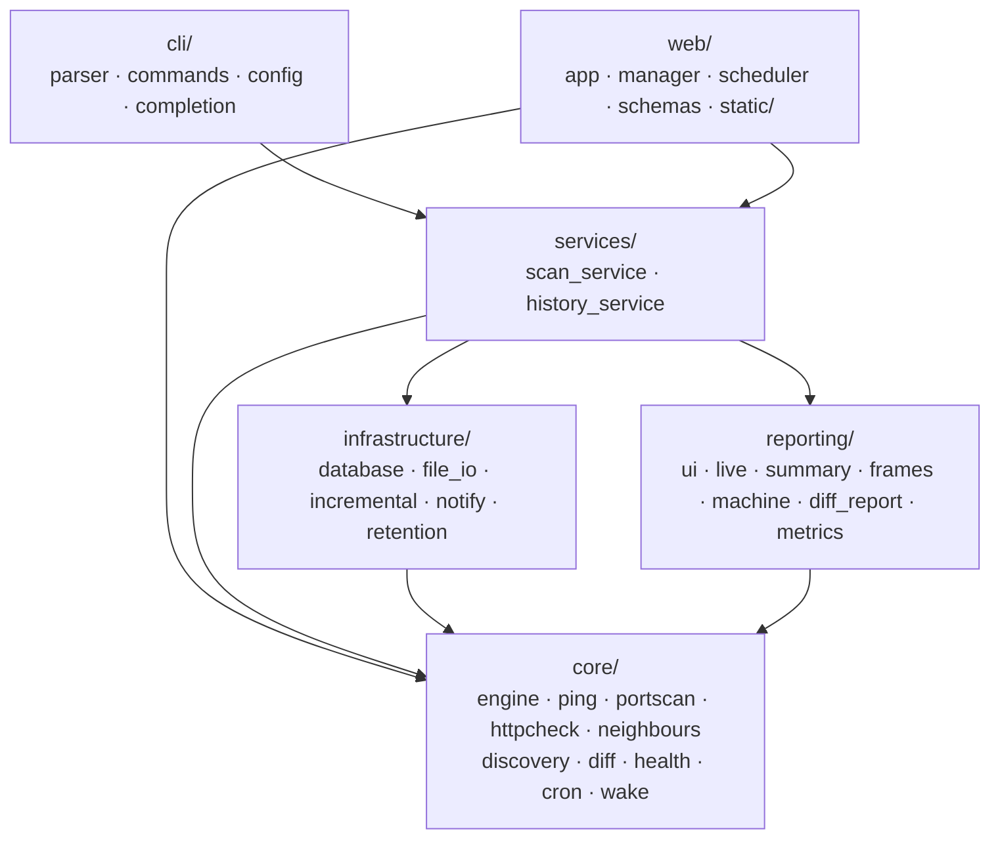
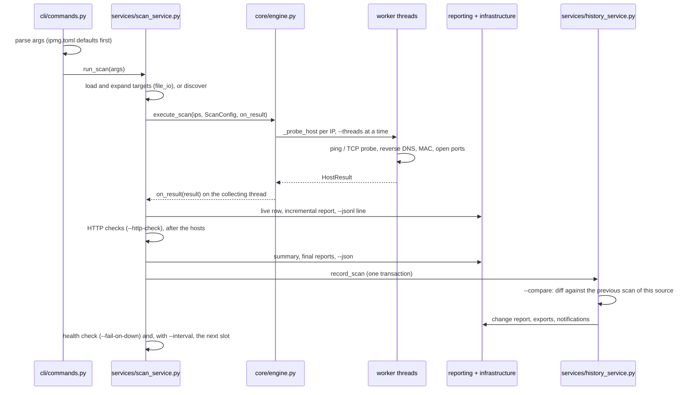

# Architecture

How IPMG fits together, for contributors. It describes the 3.x code on
`main`; the v4 rewrite has its own plan in
[docs/v4/PLAN.md](https://github.com/sameeralam3127/ipmg/blob/v4/docs/v4/PLAN.md).

**Contents**

[Layers](#layers) ·
[Life of a scan](#life-of-a-scan) ·
[History database](#history-database) ·
[IPMG Web](#ipmg-web) ·
[Extension points](#extension-points) ·
[Known constraints](#known-constraints)

---

## Layers

| Layer | Owns | Must not |
| --- | --- | --- |
| `cli/` | Turning a command line (and `ipmg.toml`) into arguments, dispatching `ipmg`, `web`, `history`, `diff`, `wake`, `completion` | Probe hosts or touch the database itself |
| `services/` | The workflows: a CLI scan pass, recording history, comparing scans, retention | Know about argparse beyond reading attributes off `args` |
| `core/` | Probing and pure logic: the engine, ping, TCP and HTTP checks, MAC lookup, discovery, change detection, health checks, cron | Print, write files, or open the database |
| `infrastructure/` | Side effects: SQLite, report files, notifications, pruning | Decide *what* changed; that is `core/diff.py` |
| `reporting/` | Everything a person or a script reads: terminal output, report tables, `--json`, Prometheus text | Probe hosts |
| `web/` | IPMG Web: the FastAPI app, background scans, schedules, the bundled frontend | Reimplement scanning: it calls the same engine |

`utils/helpers.py` holds the shared console, logging setup, and the reverse
DNS cache. `exceptions.py` defines `IPMGError` and its subclasses; anything
raised as an `IPMGError` reaches the user as a one-line error and exit code `1`.

---

## Life of a scan

1. **Targets.** `infrastructure/file_io.py` reads files (`.txt`, `.csv`,
   `.json`, `.xlsx`) and free text, expands CIDR blocks and ranges, removes
   duplicates, and stops at 65,536 hosts. `core/discovery.py` supplies them
   for `--discover`.
2. **Probing.** `core/engine.py:execute_scan` runs `_probe_host` for every IP
   on a thread pool of `--threads` workers. Each worker decides reachability
   (`_reachability`: `core/ping.py` runs the system `ping`, `core/portscan.py`
   makes TCP connections for `--probe tcp`), then, on the same worker,
   resolves the name through `HostnameCache` (bounded by `--dns-timeout`),
   reads the MAC from the neighbour table (`core/neighbours.py`), and checks
   ports. TCP connects from every worker share one bounded pool.
3. **Collecting.** Results come back on the calling thread through
   `on_result`, in completion order. `scan_service` hands each one to the
   live display (`reporting/live.py`), the incremental report writer
   (`infrastructure/incremental.py`, so an interrupted scan leaves a usable,
   resumable report), and `--jsonl` (`reporting/machine.py`).
4. **Reports.** `reporting/frames.py` turns results into a `ReportTable`
   whose columns come from `report_columns(config)`: the default set, plus
   `Probe`, `MAC Address`, and `Vendor` only when the scan asked for them.
   `file_io.save_results` renders every format from that one table.
5. **History.** `HistoryService.record_scan` stores the scan, its results, and
   its HTTP checks in one transaction. With `--compare`,
   `compare_with_previous` loads snapshots of this scan and the previous
   comparable scan of the same source and hands them to `core/diff.py`.
6. **Changes.** `compare_snapshots` is pure: it returns a `ScanDiff` of
   `HostChange`s, each with a type and a severity. `reporting/diff_report.py`
   prints and exports it, and `infrastructure/notify.py` sends it.
7. **Interval mode.** `run_scan` repeats the pass on a fixed cadence,
   carrying on after a pass that fails (and alerting about it).

---

## History database

One SQLite file, `~/.ipmg/dashboard.db` unless `--db` says otherwise, shared by
the CLI and IPMG Web, which may be separate processes at the same time. It
runs in WAL mode with a 30-second busy timeout
(`infrastructure/database.py`), and new columns are added in place by
`Database._migrate`, so an old database keeps working.

| Table | One row per | Key columns |
| --- | --- | --- |
| `scans` | scan | `source` (the input file, `auto-discovery`, `schedule:<name>`, ...), `status` (`running`, `complete`, `cancelled`, `failed`, `interrupted`), `config` (the `ScanConfig` as JSON) |
| `results` | host in a scan | `ip`, `status`, `latency`, `hostname`, `open_ports`, `method`, `mac`, `vendor` |
| `http_checks` | URL in a scan | `url`, `ok`, `status_code`, `response_ms`, `final_url`, `failure` |
| `schedules` | IPMG Web schedule | `targets`, `interval_minutes` or `cron`, `paused`, `next_run_at`, `last_scan_id` |

Change detection reads two scans through `Database.snapshot` and
`Database.http_snapshot`. The baseline is the newest earlier scan whose
status is `complete` or `cancelled` (`COMPARABLE_STATUSES`), from the same
source unless `--compare-any-source` is given. The inventory, Prometheus
metrics, and retention (`infrastructure/retention.py`) are queries over the
same tables.

---

## IPMG Web

`ipmg web` (`web/server.py`) builds the app in `web/app.py` and serves it with
uvicorn on `127.0.0.1` by default.

- **REST API** under `/api/v1`. `web/schemas.py` is the contract, and
  `tests/test_api_contract.py` compares the generated OpenAPI schema with the
  committed snapshot, so a change is never accidental. `/api/v1` only grows.
- **Authentication.** Every API route and the WebSocket need the token from
  the start-up link (`IPMG_WEB_TOKEN` pins it). Every response carries a
  Content-Security-Policy and anti-framing headers.
- **Scans** run in background threads in `web/manager.py:ScanManager`, which
  calls the same `execute_scan` the CLI does, at most `--max-scans` at once.
  Results go to the database in batches (`ResultWriter`) and to every
  WebSocket subscriber per host. On startup, scans a stopped process left
  `running` become `interrupted`; on shutdown, running scans are stopped.
- **Schedules.** `web/scheduler.py` wakes every 15 seconds, starts due
  schedules through the same manager under the source `schedule:<name>`, and
  skips a run while the previous one is still going.
- **Live events.** `GET /api/v1/ws` streams `scan_started`, `result`, and
  `scan_finished`. A subscriber that falls more than 1,000 events behind is
  disconnected and reloads from the REST API.
- **Frontend.** `web/static/` is plain ES modules with no build step and no
  CDN: `api.js` (REST and WebSocket client), `views.js` (one function per
  page), `charts.js` (hand-rolled SVG), and `app.js` (the hash router).
- **The GitHub Pages demo** is the same `static/` folder, copied to `demo/` on
  the website by `.github/workflows/deploy-pages.yml`. On a `*.github.io` host
  (or with `?demo`), `api.js` answers every call from the seeded data in
  `demo.js` instead of the server.

---

## Extension points

- **A new way to check a host** (as TCP probing and MAC lookup were added):
  extend `ScanConfig` and `HostResult` in `core/engine.py` with defaults, do
  the work in `_probe_host` or `_reachability`, and add a report column in
  `reporting/frames.py:report_columns` that appears only when the setting is
  on, so default reports stay byte-identical. Then store it in
  `Database._insert_results` (with a `_migrate` entry), show it in
  `reporting/live.py`, and add it to `HostResultRow` in `web/schemas.py`
  (a new, optional field) and the snapshot.
- **A check of something other than a host** (as HTTP checks were): give it
  its own module in `core/`, its own result type, report file, and history
  table, and changes of its own in `core/diff.py`, rather than new columns on
  host rows.
- **A report format:** add a renderer to `file_io.render_report` and its name
  to `REPORT_FORMATS` in `infrastructure/incremental.py`. Say whether it can
  be appended to as hosts finish (`STREAMING_FORMATS`) or must be
  re-snapshotted (`SNAPSHOT_FORMATS`).
- **A notification channel:** add a payload builder and a delivery to
  `_deliveries` (and `send_alert`) in `infrastructure/notify.py`, and its
  flag to `_add_notify_arguments` in `cli/parser.py`. Delivery failures must
  be reported, never raised.
- **A command:** a `build_*_parser` in `cli/parser.py`, a handler in
  `_COMMANDS` in `cli/commands.py`, and it is in shell completion
  automatically once it is listed in `cli/completion.py:commands`.
- **A scan flag** needs only the parser: `ipmg.toml` and shell completion read
  the parser, so both pick it up.

---

## Known constraints

- **One `ping` process per host.** IPMG uses the system `ping` so it never
  needs root or raw sockets, but on very large ranges a single-process sweeper
  such as fping is faster.
- **One SQLite file, one writer at a time.** WAL lets readers and the writer
  overlap, and every connection waits up to 30 seconds for a lock, but writes
  from the CLI and IPMG Web still take turns. Network filesystems may not
  support WAL.
- **Schedules run only while IPMG Web runs.** A run that fell due while it was
  stopped happens once at the next start. For scans without IPMG Web, use
  `--interval` or the service templates in `contrib/`.
- **MAC addresses only on the local link**, read from the operating system's
  neighbour table after a host answers.
- **Times are local, naive timestamps** (`YYYY-MM-DD HH:MM:SS`), as stored
  since 1.x, so a database moved between time zones compares wall-clock times.
